<div align="center">
  
  <br><br>
  <a href="https://git.io/typing-svg">
    
  </a>
  <br>
  <p>
    
    &nbsp;
    
  </p>
</div>

---

## 🧠 About Me

```python
class Madhav:
    def __init__(self):
        self.name        = "Madhav P"
        self.role        = "Software Engineer"
        self.education   = "BCA '26"
        self.focus       = ["Backend Architecture", "Data Pipelines", "System Design"]
        self.languages   = ["Python", "JavaScript", "TypeScript", "SQL", "C/C++"]
        self.frameworks  = ["FastAPI", "Django", "Flask", "React", "Node.js"]
        self.databases   = ["PostgreSQL", "MongoDB", "MySQL", "Supabase", "Firebase"]
        self.cloud_tools = ["Docker", "Git", "GitHub Actions", "Linux", "AWS"]
        self.platforms   = ["LeetCode", "HackerRank", "GFG"]
        self.interests   = ["Distributed Systems", "Applied AI", "Space", "Geopolitics"]

    def current_focus(self):
        return "Building scalable backend systems 🚀 & high-throughput data workflows"

    def philosophy(self):
        return "Simple systems scale. Code cleanly, test thoroughly, ship reliably. 💡"

me = Madhav()
print(me.current_focus())
```

- 🚀 **Building**: Scalable backend services, robust REST APIs, and automated data pipelines.
- 💡 **Mindset**: Clean code, defensive design, low-latency execution, and simple architectures that scale.
- 🎯 **Current Focus**: Mastering production-scale Python architectures, asynchronous systems, and modern cloud deployment.
- 💬 **Ask me about**: Python internals, API design, database schemas, and backend architecture.

---

## 🏆 GitHub Trophies

<div align="center">
  
</div>

---

## 🛠️ Tech Arsenal

### 💻 Languages & Core


### ⚙️ Backend & Systems Architecture


### 🎨 Frontend & Interface Engineering


### 🗄️ Databases & Storage Engines


### 📊 Data & Applied AI


### 🔧 Cloud, DevOps & Tooling


---

## 📊 GitHub Stats

<div align="center">
  <!-- 1. Activity Graph (Full Width) -->
  
</div>

<br>

<div align="center">
  <!-- 2. Profile Details & 3. Streak Stats -->
  
  &nbsp;
  
</div>

<br>

<div align="center">
  <!-- 4. Top Languages by Repo & 5. Top Languages by Commit -->
  
  &nbsp;
  
</div>

<br>

<div align="center">
  <!-- 6. Productive Time -->
  
</div>

---

## 🚀 Featured Projects

### 🤖 [FinSathi — LLM Financial Advisory Engine](https://github.com/Madhav-P-2005/LLM_Powered-Financial-Service-ChatBot)
> An intelligent financial query system built with dual-provider LLM orchestration (HuggingFace + OpenAI) for high availability, verifiable citations, and streaming responses.
- **Architecture**: Asynchronous Flask REST backend decoupled with a React 18 / Tailwind frontend and CORS proxying.
- **Tech Stack**: `Python` • `Flask` • `React` • `Tailwind CSS` • `OpenAI SDK` • `HuggingFace API`
- **Links**: [📁 Source Repository](https://github.com/Madhav-P-2005/LLM_Powered-Financial-Service-ChatBot) &nbsp;|&nbsp; [🌐 Live Application](https://finsathi-chatbot-madhavp.vercel.app)

---

### 📝 [React Task Orchestrator](https://github.com/Madhav-P-2005/React.Js-ToDo-App)
> High-throughput client-side task workspace engineered with modern React 19, zero-lag local persistence, and responsive scheduling.
- **Architecture**: Modular component tree with custom state hooks, search filtering, and persistent localStorage schema.
- **Tech Stack**: `React 19` • `Vite 7` • `Bootstrap 5` • `SCSS`
- **Links**: [📁 Source Repository](https://github.com/Madhav-P-2005/React.Js-ToDo-App) &nbsp;|&nbsp; [🌐 Live Application](https://to-do-app-madhavp.vercel.app)

---

### 🎮 [Algorithmic Tic-Tac-Toe State Engine](https://github.com/Madhav-P-2005/Tic-Tac-Toe)
> Zero-dependency game state engine featuring algorithmic single-player heuristics and interactive DOM event management.
- **Architecture**: Coordinate matrix evaluation, stateful turn verification, and responsive CSS grid rendering.
- **Tech Stack**: `JavaScript (ES6+)` • `HTML5` • `CSS3`
- **Links**: [📁 Source Repository](https://github.com/Madhav-P-2005/Tic-Tac-Toe)

---

## ✍️ Engineering Philosophy

<div align="center">
  <p><em>"Simplicity is prerequisite for reliability. Measure twice, architect cleanly, test thoroughly, and ship with confidence."</em></p>
  
</div>

---

## 🌐 Connect With Me

<div align="center">
  <p>
    <a href="https://www.linkedin.com/in/madhav-p-156b9b290" target="_blank"></a>
    &nbsp;
    <a href="https://leetcode.com/u/madhavp_14/" target="_blank"></a>
    &nbsp;
    <a href="https://www.hackerrank.com/profile/madhavp_14" target="_blank"></a>
    &nbsp;
    <a href="mailto:madhavp2023@gmail.com"></a>
    &nbsp;
    <a href="https://x.com/madhavp_14" target="_blank"></a>
    &nbsp;
    <a href="https://discord.gg/dReaKKZpzr" target="_blank"></a>
  </p>
</div>

---

<div align="center">
  
  <br>
</div>